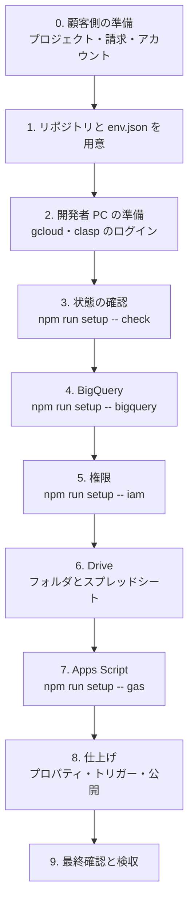

# 環境構築手順（フェーズ1 基盤づくり）

2026-11-15 時点

## この手順のゴール

顧客の Google 環境の中に、原価管理App の「空の一式」を作り、開発者が作業できる状態にします。終わった時点で次がそろいます。

- BigQuery のデータセット（`master`・`history`・`mart`・`explore`）と、テーブル・ビュー
- Drive の取込用フォルダと、設定・中間テーブルのスプレッドシート
- Apps Script の5つのプロジェクト（01 ファイル登録、02-03 取込・整形App、04 閾値アラート、05 自然言語検索、06 コントロールパネル）
- 開発者・実行用アカウント・読み取り専用サービスアカウントの権限

データはまだ入っていません。顧客のデータ構造に合わせた設計（`v_variance` など）はフェーズ2で行います。

## 全体の流れ



`npm run setup -- <ステップ>` は、**`--apply` を付けないと実行するコマンドを表示するだけ**で、何も変更しません。まず表示だけで内容を確かめ、問題なければ `--apply` を付けて実行します。すでにあるもの（データセット・テーブル・サービスアカウント・スクリプト）は作り直さずに飛ばすので、途中で止まっても同じコマンドをもう一度実行できます。

## 役割分担

| 作業 | 顧客の管理者 | 開発者 |
| --- | --- | --- |
| 0. プロジェクト作成・請求の紐付け・アカウント発行 | ○ | 依頼する |
| 1〜5. リポジトリ・BigQuery・権限 | | ○ |
| 6. Drive のフォルダ・スプレッドシート | 共有ドライブを使う場合は作成に協力 | ○ |
| 7〜8. Apps Script | API キーなど秘密の値の入力 | ○ |
| 9. 検収 | ○ | ○ |

## 0. 顧客側の準備（作業依頼書で依頼）

事前診断のヒアリング（C. Google 環境）の回答をもとに、顧客の管理者に次を依頼します。依頼の仕方は、フェーズ1 の作業依頼書（画面キャプチャ付き）にまとめます。

1. Google Cloud のプロジェクトを作り、請求先アカウントを紐付ける（リージョンの決まりがあれば確認する）
2. 開発者用のアカウントを発行する（ヒアリングの質問7）
3. 開発者に、そのプロジェクトの「オーナー」、または「編集者」と「プロジェクト IAM 管理者」を付ける（構築のあいだだけ。終わったら下げてよい）
4. アプリを動かす共用アカウント（例: `system@顧客ドメイン`）を発行する（ヒアリングの質問8）
5. 組織ポリシーで、外部への通信（Claude API・Google Chat）が止められていないか確認する

サービスアカウントの鍵は作りません。組織ポリシーで鍵の作成が禁止されていても動くように、鍵を使わない方式（なりすまし）を標準にしています。

## 1. リポジトリと env.json を用意する

1. このリポジトリを、顧客ごとの新しいリポジトリにコピーする（誰が持つかはヒアリングの質問10）
2. `config/env.example.json` を `config/env.json` にコピーする
3. 今わかる値を記入する。この時点で必要なのは次の3か所

| 項目 | 書く内容 |
| --- | --- |
| `gcp.projectId`・`gcp.location` | 手順0で作ったプロジェクトの ID と、データを置く場所（東京なら `asia-northeast1`） |
| `access.developers` | 開発者のアカウント（`user:メールアドレス` の形、複数可） |
| `access.runner` | GAS を動かす共用アカウント（`user:メールアドレス`） |

`gas` の ID は手順6・7で埋めます。`mcp.bigqueryCredentialsPath` は空のままにします（鍵を使わない方式）。

## 2. 開発者 PC の準備

1. リポジトリ直下で `npm install`
2. `gcloud auth login` で、開発者のアカウントでログインする
3. [script.google.com/home/usersettings](https://script.google.com/home/usersettings) で「Google Apps Script API」をオンにし、`npx clasp login` でログインする

どちらのログインも、組織のセキュリティ設定によって時々切れます。`Reauthentication failed` や `invalid_rapt` と出たら、もう一度ログインします。

## 3. 状態を確認する

```text
npm run setup -- check
```

読むだけのコマンドです。○ と × の一覧が出るので、× の行を見て次の手順に進みます。新しい環境では、この時点で BigQuery・サービスアカウント・Apps Script が × になるのが正常です。

## 4. BigQuery を作る

```text
npm run setup -- bigquery            （表示だけ）
npm run setup -- bigquery --apply    （実行）
```

やること:

1. BigQuery API を有効にする
2. データセット `master`・`history`・`mart` を `gcp.location` に作る
3. `build/sql/` の SQL を順に流す（01 マスタ、02 履歴、03 `v_variance`、05 `explore`）。流す前に1本ずつ dry run で確かめ、エラーがあれば止まる

`sql/04`（旧環境向けの列追加）と `sql/06`（検証用）は流しません。テーブルがすでにあるデータセットの SQL は飛ばします。

## 5. 権限を付ける

```text
npm run setup -- iam
npm run setup -- iam --apply
```

| 対象 | 付ける権限 | 理由 |
| --- | --- | --- |
| 開発者 | BigQuery ユーザー、BigQuery データ編集者 | テーブル・ビューを作る、クエリを流す |
| 実行用アカウント | BigQuery ジョブユーザー、BigQuery データ編集者 | GAS が読み込み（03）と集計（04・05）を行う |
| 読み取り専用 SA | BigQuery ジョブユーザー、BigQuery データ閲覧者 | Claude Code が月報のために読む |
| 開発者 → 読み取り専用 SA | サービス アカウント トークン作成者 | 鍵なしで SA になりすますため |

実行が終わったら、Claude Code から BigQuery を読む開発者は、自分の PC で次を1回実行します（ブラウザで許可）。表示されたコマンドをそのまま使えます。

```text
gcloud auth application-default login --impersonate-service-account=<読み取り専用SA>@<プロジェクトID>.iam.gserviceaccount.com
```

## 6. Drive のフォルダとスプレッドシートを用意する

ここは画面での作業です。共有ドライブがあれば、そこに作ります（担当者が退職しても消えないため）。

1. フォルダを作る: 取込フォルダ、処理済みフォルダ、ソース種別ごとのアップロード先フォルダ（売上・原価・生産・月報・売上予算・原価予算）
2. `既成ファイル/取込_設定シート_修正後.xlsx` と `既成ファイル/中間テーブル.xlsx` をアップロードし、「Google スプレッドシートとして開く」で変換して保存する
3. 取込_設定シートの「アップロード設定」シートに、ソース種別ごとのフォルダ ID を書く
4. 中間テーブルの「設定」シートの `PROJECT_ID`・`LOCATION`・`SPREADSHEET_ID` を、この環境の値に書き換える（03 DataRoad はここを読む）
5. `config/env.json` の `gas.fileUpload`・`gas.importApp` に、スプレッドシートとフォルダの ID を書く

ID は、開いたときの URL の `/d/` や `/folders/` のあとの長い文字列です。

## 7. Apps Script を作って反映する

```text
npm run setup -- gas
npm run setup -- gas --apply
```

`scriptId` が空のプロジェクトを作り、`config/env.json` に ID を書き込んでから、5つともコードを反映します。06 コントロールパネルは、02-03 と 04 のコードを同梱してから反映します（`scripts/build_panel.js`）。作るプロジェクトは、開発者のマイドライブにできます。共用アカウントや共有ドライブに置く場合は、作成後にオーナーを移すか、共用アカウントで `clasp login` してから実行します。

## 8. 仕上げ（Apps Script の画面で）

| 対象 | 作業 |
| --- | --- |
| 05 自然言語検索 | スクリプトプロパティ `ANTHROPIC_API_KEY` に、顧客の Claude API キーを入れる（顧客に入力してもらう） |
| 04 閾値アラート | スクリプトプロパティ `CHAT_WEBHOOK_URL` に Google Chat の Webhook URL を入れ、`setupMonthlyTrigger` を1回実行する |
| 06 コントロールパネル | スクリプトプロパティ `PANEL_ADMINS` に管理者のメールアドレス（カンマ区切り）を入れる。パネルから Chat に送る場合は `CHAT_WEBHOOK_URL` も 04 と同じ値を入れる |
| すべて | 最初の実行で出る「承認が必要です」を、実行用アカウントで許可する |
| 01・05・06（Web アプリ） | フォルダで `npx clasp create-deployment --description "初版"` を実行して公開し、URL を `gas.fileUpload.webAppUrl`・`gas.nlSearch.webAppUrl`・`gas.panel.webAppUrl` に書く。Looker Studio を作ったら `dashboard.lookerStudioUrl` にも書き、`npm run gas:push:panel` で反映し直す（パネルのリンクになる） |

API キーや Webhook URL は秘密の値なので、`config/env.json` やリポジトリには書きません。

## 9. 最終確認と検収

```text
npm run setup -- check
```

すべて ○ になったら、動作を確認します。

- 05 で `nlCheckSetup` を実行し、BigQuery につながること（データが空なので件数は 0）
- 01 の Web アプリが開き、「ソース種別」に設定シートの値が出ること
- 02-03 で `loadConfig` を実行し、エラーが出ないこと（`processImportFiles` はファイルを動かすので、この段階では実行しない）
- 06 の Web アプリが開き、右上に「管理者」と出ること。ステップ1〜3の状態が「確認できません」にならないこと

### 検収チェックリスト（フェーズ1 の完了条件: 開発側のアクセス確保）

- [ ] `npm run setup -- check` がすべて ○
- [ ] 開発者が BigQuery でテーブルを作れる・クエリを流せる
- [ ] 開発者が Claude Code から読み取り専用 SA で BigQuery を読める
- [ ] 開発者が 5つの Apps Script に clasp で反映できる
- [ ] Drive のフォルダ・スプレッドシートを開発者と実行用アカウントが編集できる
- [ ] `config/env.json` をコミットし、顧客用リポジトリに push した

## 困ったとき

| 症状 | 原因と対処 |
| --- | --- |
| `Reauthentication failed`・`invalid_rapt` | ログインの期限切れ。`gcloud auth login`・`npx clasp login` をやり直す |
| check で「GCP プロジェクト … 見つからないか、権限がない」 | プロジェクト ID の書き間違い、または手順0の権限がまだ付いていない |
| 「請求先アカウントの紐付け … 確認できない」 | 課金情報を見る権限がないだけのことがある。顧客の管理者に紐付け済みか確認する |
| bigquery で dry run のエラー | SQL の参照先がまだ無い。前の SQL が流れたか、データセットの場所（`location`）がそろっているか確認する |
| gas で「作れませんでした」 | Apps Script API がオフ、または clasp が未ログイン（手順2） |
| GAS 実行時に「ENV is not defined」 | `環境設定_自動生成.gs` が反映されていない。`npm run setup -- gas --apply` をやり直す |

## 関連

- 構成と各機能: [構成ガイド.md](構成ガイド.md)
- 環境ごとの値の仕組み: [構成ガイド.md](構成ガイド.md) の「環境ごとの設定」
- GAS の反映の詳細: [../gas/README.md](../gas/README.md)
